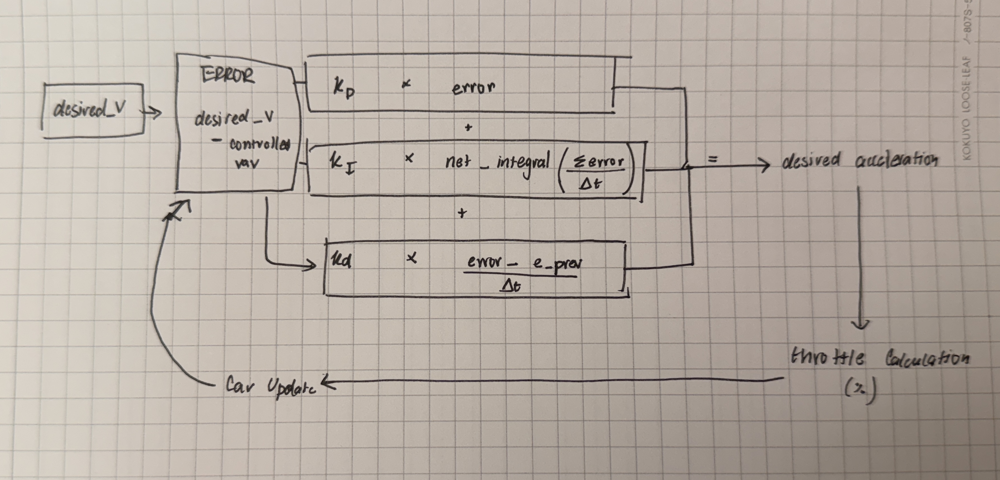
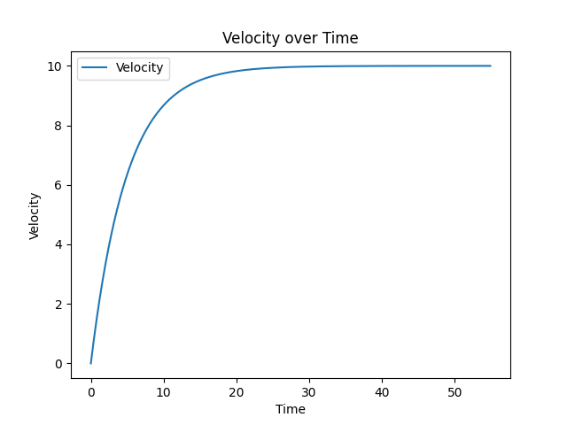
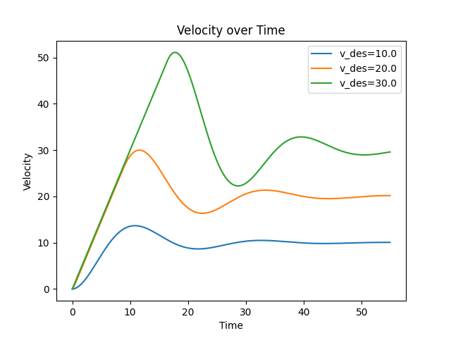
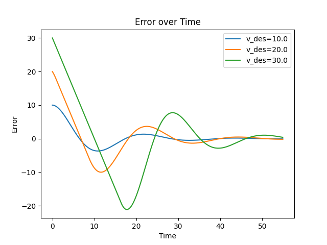
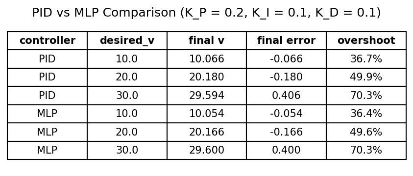
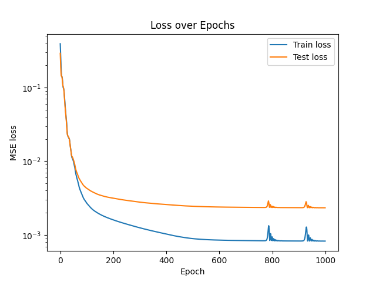
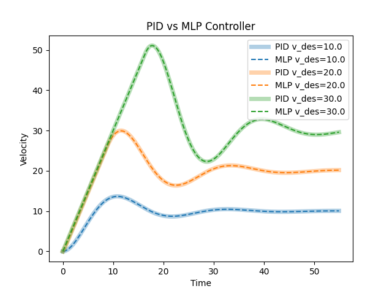
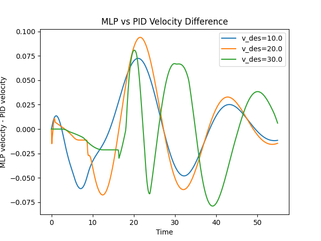

# Onboarding Project for Autonomous Driving
by Ash (Ashmita Dua)

I made the basic PID controller using teh described algorithm, and as an extension I also implemented a Multi-layer preceptron to act as a system to update the weights

The File Structure for the project:

```
fs-5-software-intro-projects/
├── .gitignore
├── PLEASE-README.md
├── requirements.txt                 # numpy, matplotlib, torch
├── venv/                            # Python environment (not tracked)
└── auto/
    ├── pid_template.py              # car model + PID controller functions
    ├── run_template.py              # runs the PID car and plots velocity/error
    ├── mlp_pid.py                   # generates PID data, trains the MLP, compares it with the PID
    ├── models/
    │   └── mlp_controller.pt        # trained MLP controller (TorchScript)
    ├── class-versions/
    │   ├── pid_template_old.py
    │   └── project_description_old.md
    ├── documentation-given-pd/
    │   ├── project_description.md
    │   ├── flowchart.drawio.png
    │   └── pid-equation-all-terms.png
    └── project-outputs/
        ├── WriteUp.pdf
        ├── FS-Poster.pdf
        ├── Images/
        │   ├── Flowchart.JPG
        │   └── Notes.jpg
        ├── P-only-graphs/
        │   ├── velocity_KP0.1_KI0_KD0.png
        │   └── velocity_KP0.2_KI0_KD0.png
        ├── PID-graphs/
        │   ├── velocity_KP0.2_KI0.1_KD0.1.png
        │   └── error_KP0.2_KI0.1_KD0.1.png
        └── MLP-graphs/
            ├── comparison_table.png
            ├── loss.png
            ├── throttle_prediction.png
            ├── pid_vs_mlp_velocity.png
            └── pid_vs_mlp_difference.png
```

## Diagram of System flow right now:

Here I've tried to explain the equations etc I have used through the code as part of the PID



Here's my notes on the same: [Notes](auto/project-outputs/Images/Notes.jpg)

## Varying Desired Velocity (K_P = 0.2, K_I = 0.1, K_D = 0.1)
From the step 7, I changed the desired velocity here are the various results I got

| desired_v | final v | overshoot |
|---|---|---|
| 10.0 | 10.066 | 36.7% |
| 20.0 | 20.180 | 49.9% |
| 30.0 | 29.594 | 70.3% |

## Main graphs and data visualised

### P only, desired_v = 20 (K_P = 0.2)



### Velocity over Time



### Error over Time



## MLP

The multi-layer preceptron is trained to update teh K_p, K_i, K_d weigths. 

> They were trained on over 11,000 data points (8,800 train / 2,200 test), generated sythetically
> - Data was produced by running the model through 20 episodes of 550 steps, each with a fresh car, while changing the desired velocity every 200 steps (random, 0 to 40 m/s)
> - Training data controller: K_P = 0.2, K_I = 0.1, K_D = 0.1
>
> The system architecture for the MLP is:
> - 3 linear layers: 3 → 16 → 16 → 1 (2 hidden layers of 16 neurons)
> - ReLU activation, $\text{ReLU}(x) = \max(0, x)$
> - Input: `[v, desired_v, net_integral]`, standardized with the training data's mean and std
> - Output: throttle percentage, -1 to 1
> - Training: 1,000 epochs, Adam (lr = 0.01), MSE loss, final train loss 0.00083, final test loss 0.0023, 2.0 s on MPS
> - Saved model: `auto/models/mlp_controller.pt`

Here's a comparison table between the two approaches:

| controller | desired_v | final v | final error | overshoot |
|---|---|---|---|---|
| PID (K_P = 0.2, K_I = 0.1, K_D = 0.1) | 10.0 | 10.066 | -0.066 | 36.7% |
| PID (K_P = 0.2, K_I = 0.1, K_D = 0.1) | 20.0 | 20.180 | -0.180 | 49.9% |
| PID (K_P = 0.2, K_I = 0.1, K_D = 0.1) | 30.0 | 29.594 | 0.406 | 70.3% |
| MLP | 10.0 | 10.054 | -0.054 | 36.4% |
| MLP | 20.0 | 20.166 | -0.166 | 49.6% |
| MLP | 30.0 | 29.600 | 0.400 | 70.3% |



### Loss over Epochs




### PID vs MLP Controller



### MLP vs PID Velocity Difference


